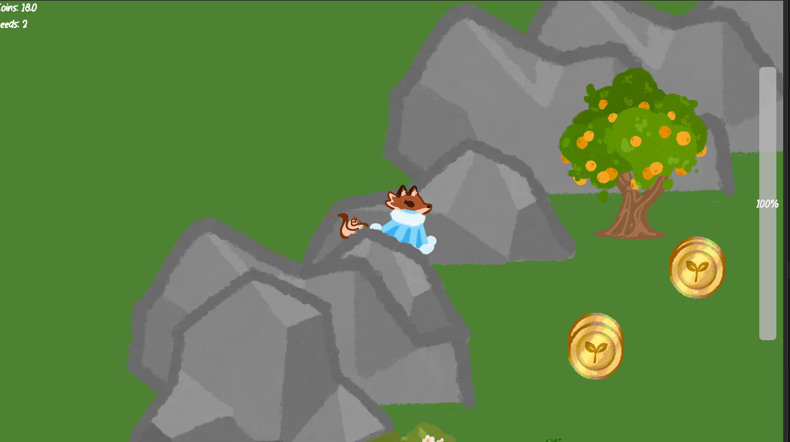
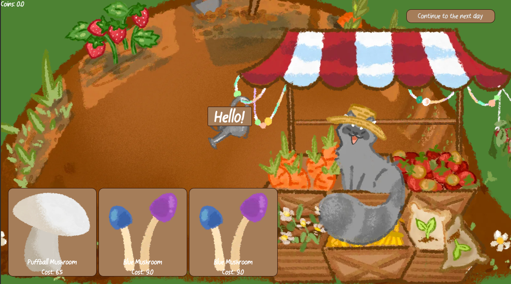

# Terrafried: Blargh's Revenge, featuring John

This is a game where you have to collect all the seeds without getting caught by the various enemies trying to get you.

After you collect all the seeds, return to Ratticus and get some upgrades from Heidi, and begin all over again.

## How to play

This game can be played at [itch.io](https://viywolf.itch.io/terrafried-blarghs-revenge-featuring-john). It is available as a web playable and windows executable.

## Credits

This game was made with Godot 4.7.

#### Art
The logo was made by Viy.

All other assets are from Terra by Hack Club.

Some assets from Terra may have been modified.

## Terra Telephone

This game is part of a collaborative project. Each week, participants work on the game alone before sending it to the next person. When the next person recieves it, they will have no idea what it's like or what features have or have not been implemented.

Once everyone has gone, we will see what strange additions people have made and how the game turns out!

DO NOT READ BELOW IF YOU ARE PARTICIPATING AND IT IS NOT YOUR TURN.

### Note for participants
Documentation for code can be found in the code comments.
For particularly complicated systems please refer to the `./docs`

### Week 1 Features (Viy)
- Added the base features such as walking and obstacles
- Added an enemy that will try to follow you and deal damage
- Collect all seeds and return to Ratticus to continue
- Shop where you can buy upgrades
	- Current upgrades:
	- Super speed
	- Slowness
	- Less tax
	- Inverted controls
- Made a basic tutorial level

### Week 2 Features (Niko)
- Stylised some UI (health bar is now a glass of cider)
- Added an 'attack'. Poncho can throw rotten tomatoes at enemies to knock them back
- (for devs) Level creation tools (auto wall generation)
- Level selection screen & Level system (stages)
- 

### What's next?

This is what isn't working properly:

- I overused get_tree().process_frame so there's random flickering sometimes especially when the level is complete.
- Speech bubbles don't interrupt properly

Here's some ideas that could be added next (these do not have to be added if you don't want to!)
- Diverse enemy types with abilities
- Player can attack
- More shop items
- More stages
- More interactables (maybe some items that give you temporary abilities when you pick it up?)
